# Bathsheba Project RoboAI

A robotics project focused on 7-DOF manipulator control, planning, and perception for compliant robotic manipulation. The repository includes custom kinematic and trajectory tooling, impedance controllers, environment setups, and perception utilities for robot interaction tasks.

## Overview

- Custom kinematic stack for 7-DOF manipulators
- Verified inverse kinematics (IK) solvers
- Impedance control architectures for compliant manipulation
- Perception pipeline for pose estimation and camera-based object detection
- Simulation and trajectory planning support for robotic tasks

## Repository structure

```text
Bathsheba-Project-roboai/
├── README.md
├── requirements.txt
├── assets/
│   ├── menagerie/
│   ├── mujoco_api_reference.txt
│   └── scene_pick.xml
├── control/
│   ├── __init__.py
│   ├── CS_impedance_controller.py
│   ├── grasp_check.py
│   └── JS_impedance_controller.py
├── envs/
│   ├── __init__.py
│   └── reach_env.py
├── perception/
│   ├── __init__.py
│   ├── camera_stream.py
│   ├── detector.py
│   └── pose_estimator.py
├── planning/
│   ├── __init__.py
│   ├── cartesian_trajectory.py
│   ├── fk.py
│   ├── ik.py
│   └── trajectory.py
├── scripts/
│   ├── run_impedance.py
│   ├── run_pick_place.py
│   ├── test_control_planning/
│   │   ├── test_cartesian_trajectory.py
│   │   ├── test_circle.py
│   │   ├── test_trajectory.py
│   │   ├── test1_setpointtracking.py
│   │   ├── test2_dampingandsweep.py
│   │   ├── test3_orientationtracking.py
│   │   ├── test4_JSImpedance.py
│   │   ├── test7_nullspace_drift.py
│   │   ├── test8_pose_tracking.py
│   │   └── test9_grasp_hold.py
│   └── test_perception/
│       └── test_pose_estimator.py
└── utils/
    ├── __init__.py
    └── transform.py
```

## Folder breakdown

### control/
Contains robot control logic, including compliant impedance controllers and grasp checks.

`CS_Impedance_Controller` optionally adds null-space posture regulation for the 7-DOF arm. Pass `Kn`, `Dn` (7×7 gain matrices) and `q_null` (7-vector target posture) to the constructor; omitting them gives the original task-space-only behaviour. If `q_null` is given without `Kn` and `Dn`, it raises a `ValueError`. The posture torque is a joint-space PD law, `tau_null = Kn (q_null - q) - Dn dq`, projected as `tau += N^T tau_null`. The projector is `N = I - J_bar J`, with `J_bar = M^-1 J^T Λ` (the dynamically consistent generalised inverse) and `Λ` the damped task-space inertia already used for the impedance wrench. The projection keeps the posture torque from disturbing the end-effector impedance behaviour.

### envs/
Defines simulation and task environments used for robot interaction experiments.

### perception/
Camera utilities for the pick-and-place pipeline:
- `detector.py`: colour segmentation of the red cube and the green place patch, camera intrinsics, and pixel-to-world conversion (with depth, or by intersecting the pixel's ray with a known plane).
- `camera_stream.py`: live fixed- and wrist-camera windows.
- `pose_estimator.py`: experimental cube pose estimation from detected corners.

### planning/
Contains forward and inverse kinematics, trajectory generation, and Cartesian planning logic.

### scripts/
Houses runnable scripts and test cases for control, trajectory planning, and evaluation.

### utils/
General helper functions, such as transforms and geometric utilities.

### assets/
Static assets, scene descriptions, and supporting reference files for simulation or experiments.

## Setup

Install dependencies:

```bash
pip install -r requirements.txt
```

## Results

Values below are read off the plots in [assets/](assets/) and are approximate, except the null-space final values, which are the exact numbers printed by the script. Experiments were run in MuJoCo on the Franka Emika Panda.

### Cartesian-space (CS) impedance control

**Stiffness sweep** (`test2_stiffness_v4.png`): the measured deflection under a fixed force falls from about 94 mm at Kp = 50 N/m to about 6 mm at Kp = 800 N/m. The naive prediction F/(λ·k) underestimates deflection, especially at low stiffness. The corrected prediction A_yy·F/k, which uses the task-space inertia term, tracks the measurements closely across the whole range.

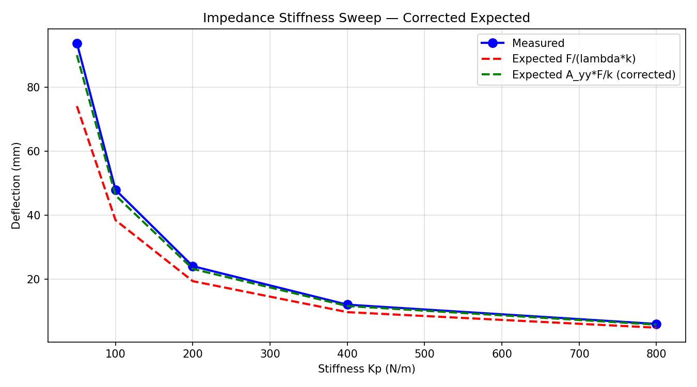

**Damping sweep** (`test3_damping_sweep.png`, K = 200 N/m): all three damping ratios converge to zero error and reach the 1 mm threshold within about 0.8 s.

| Damping | Peak error | Behaviour |
|---|---|---|
| Underdamped (0.5×) | ~34 mm | Oscillates and overshoots, settles at ~0.3 s |
| Critical (1.0×) | ~22 mm | No overshoot, settles at ~0.45 s |
| Overdamped (2.0×) | ~13 mm | Lowest peak, slowest, settles at ~0.8 s |

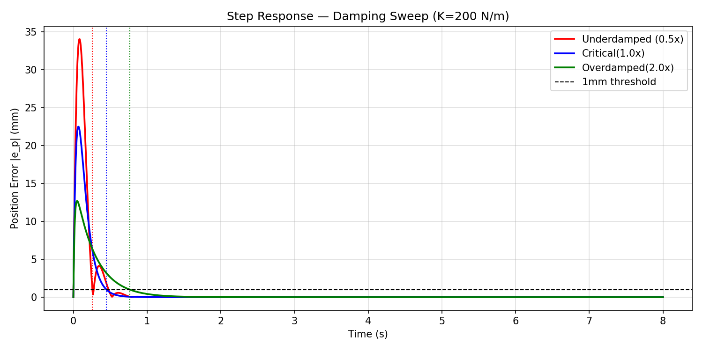

**Compliance test** (`test4_compliance.png`): a force is applied from t = 3 s to t = 5 s.
- Position error rises to a steady ~36 mm and orientation error to ~107 mrad. The end effector yields instead of fighting the load.
- Both errors return to below the 1 mm threshold within about 0.5 s of release, so there is no permanent offset.

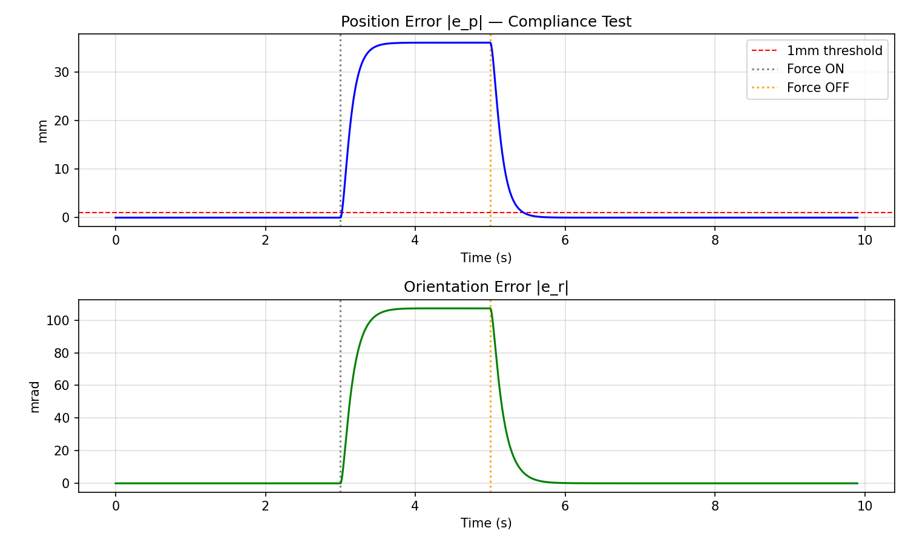

**Manual disturbance** (`test4_manual_disturbance.png`): the end effector was dragged by hand in the viewer. Position error peaked at about 77 mm and orientation error at about 330 mrad. After each drag the arm returned to the setpoint.

**Orientation tracking** (`test5_orientation_tracking.png`): ±30° step commands about x, y and z all behave the same way.
- Orientation error starts at about 524 mrad (30°) and drops below 1 mrad in roughly 0.85–0.95 s.
- Position error shows a transient of about 22–24 mm, peaking at about 0.07 s, and settles within 1 mm in about 0.4–0.6 s.

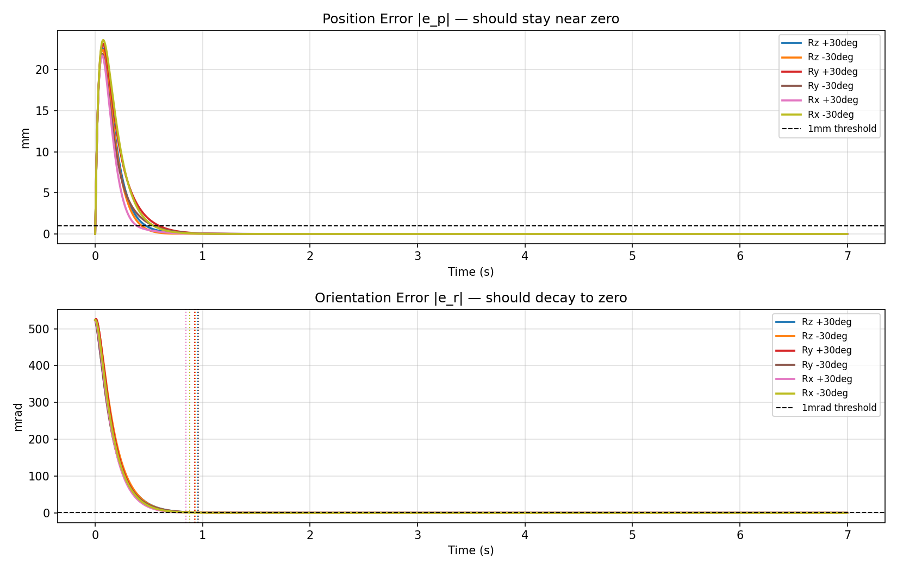

### Null-space posture control

**Elbow push** (`test7_nullspace_drift.py`): a 20 N Y-axis force on link4 from t = 1.0 s to t = 1.5 s while the end effector holds its home pose (Kp = 1000, Kr = 100, ζ = 1). With posture control the gains are Kn = 20, Dn = 2√20 per joint and `q_null` is the home configuration. Drift is measured relative to the joint angles just before the push.

| | Without posture control | With posture control |
|---|---|---|
| Peak end-effector position error | ~0.5 mm | ~0.55 mm |
| Peak orientation error | ~93 mrad | ~47 mrad |
| Peak joint drift | q1 ≈ −1.06 rad, q3 ≈ +0.58 rad, q5 ≈ +0.51 rad | q1 ≈ −0.075 rad, q3 ≈ +0.06 rad |
| Final (t = 4 s) ‖e_p‖ | 0.0002 mm | 0.0001 mm |
| Final (t = 4 s) ‖e_r‖ | 1.12e-4 rad | 5.9e-5 rad |
| Final (t = 4 s) joint drift | q1 = −1.060 rad (stays at the plateau) | max 3.1e-4 rad |

- Without posture control the push shoves the arm into a different elbow configuration. The end effector recovers, but the joints stay where the push left them, up to about 1 rad.
- With posture control the joints settle back to the home posture within about 2 s of release, and the end-effector error is still driven to zero.
- Steady-state task-space accuracy is unchanged. During posture recovery (1.6–3.0 s) the joints return to `q_null` with no measurable end-effector disturbance, consistent with the dynamically consistent projection. Peak end-effector position error is comparable (~0.5 vs ~0.56 mm), and peak orientation error roughly halves.
- The gains are fixed values, not tuned. The posture stiffness trades speed of return against how strongly the posture torque competes with the push.
- The "without" run uses the same script with the controller built without `Kn`, `Dn` and `q_null`. Its plot is `assets/test7_nullspace_drift.png`.

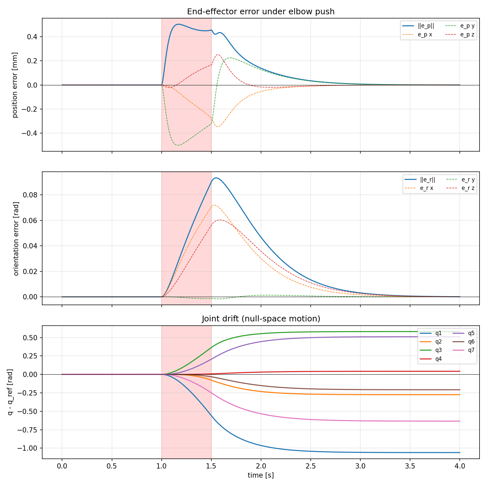

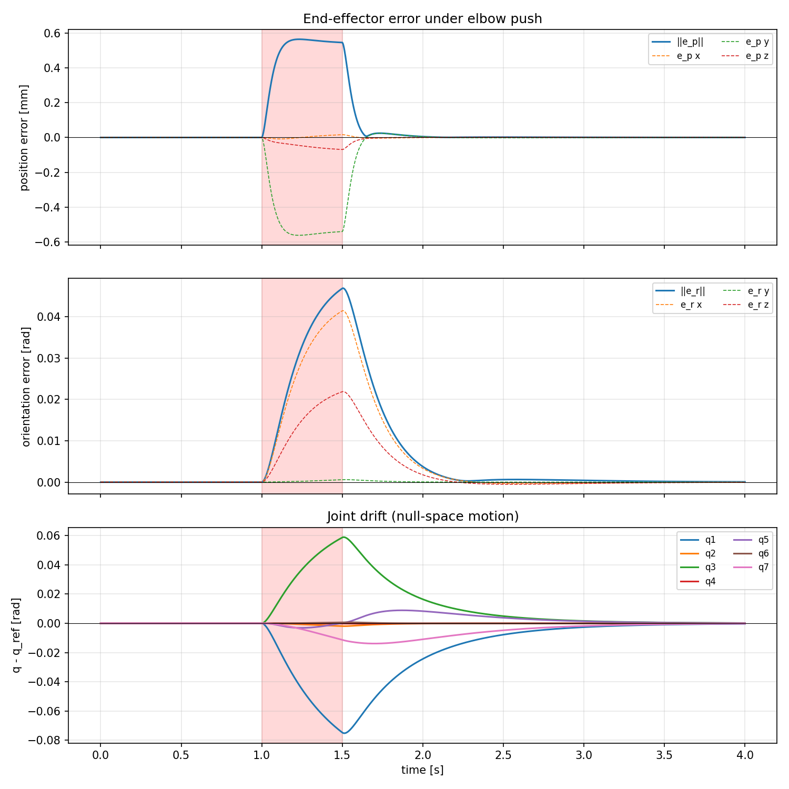

### Grasp-hold stability

**Cube slipping out of the grasp** (`test9_grasp_hold.py`): the arm picks the cube with CS impedance control, lifts it 0.20 m and holds it for 30 s. The script logs the cube's height relative to the end effector, which shows creep, and the cube's tilt from vertical, which shows rotation about the grasp axis. Each row changes only the contact settings.

| Variant | noslip | Friction cone | Cube condim / friction | Creep, first 10 s | Tilt: start → 10 s (→ 30 s) | Outcome |
|---|---|---|---|---|---|---|
| baseline | 0 | pyramidal | 3 / 1 0.005 0.0001 | 8.91 mm | 0.75° → 2.67° | fell after 22.4 s |
| noslip4 | 4 | pyramidal | 3 / 1 0.005 0.0001 | 0.17 mm | 0.56° → 1.40° (→ 2.84°) | held, still tilting |
| torsion | 0 | pyramidal | 4 / 1 0.02 0.0001 | 13.20 mm | 0.52° → 1.03° | fell after 14.6 s |
| noslip4 + torsion | 4 | pyramidal | 4 / 1 0.02 0.0001 | 13.20 mm | 0.47° → 0.47° | fell after 14.0 s |
| noslip4 + torsion 0.005 | 4 | pyramidal | 4 / 1 0.005 0.0001 | 13.22 mm | 0.46° → 0.47° | fell after 14.0 s |
| noslip10 (overlaps noslip4) | 10 | pyramidal | 3 / 1 0.005 0.0001 | 0.17 mm | 0.56° → 1.41° (→ 2.84°) | held, still tilting |
| **noslip4 + torsion + elliptic (final)** | 4 | elliptic | 4 / 1 0.02 0.0001 | **0.02 mm** | **0.47° → 0.49° (→ 0.54°)** | **held** |

- The slip has two causes: contact creep and rotation about the grasp axis.
- noslip removes most of the creep but not the slow rotation. Going from 4 to 10 iterations changes nothing: the two runs match to within 0.001 mm and 0.006°, so in the plot noslip10 is dashed over noslip4.
- Torsional friction (`condim="4"`) stops the rotation. With MuJoCo's default pyramidal friction cone it also makes the cube slide faster, even with noslip on, so the cube falls sooner than in the baseline.
- With the elliptic cone, noslip and torsional friction together hold the cube with essentially no creep or tilt.
- The final row is what the scene now uses. The cube's `condim` and `friction` are set in `assets/scene_pick.xml`. `noslip_iterations` and `cone` are set in `envs/pick_scene.py`, because `MjSpec.attach()` drops `<option>` from the attached task XML.
- `run_pick_place.py` (position servo) still completes the task with the new settings; its place error moved from 1.02 mm to 1.53 mm.

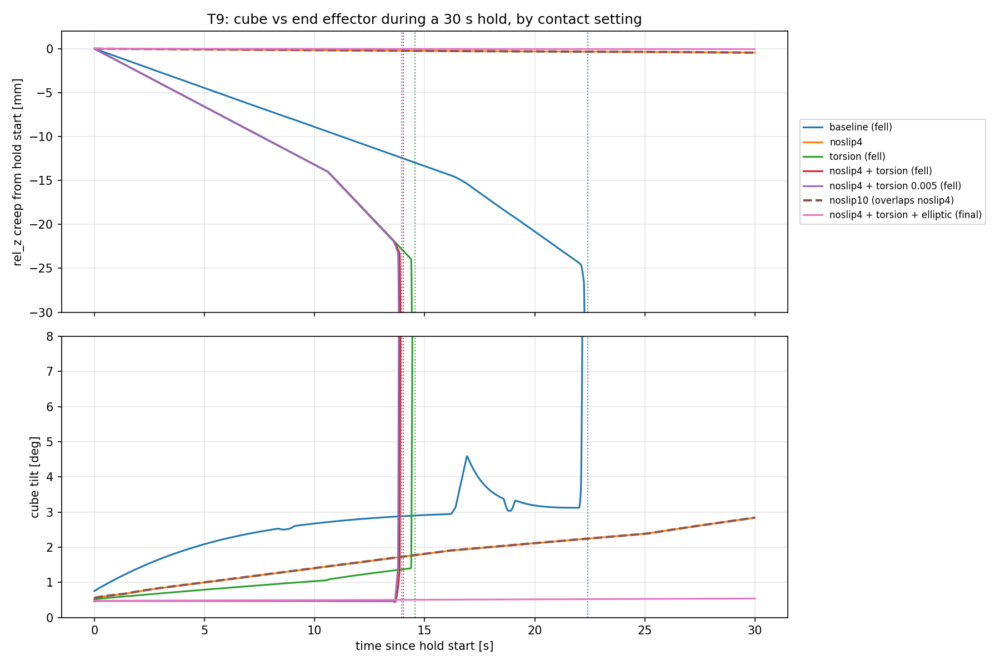

### Pick-and-place error budget

Over 20 randomized cube start poses (x, y and yaw up to ±45°), the impedance pick-and-place pipeline (`run_impedance.py`) succeeded in all 20 trials. Mean place error was 1.08 mm (max 2.30 mm) and grew with the cube's yaw. [docs/error_budget.md](docs/error_budget.md) breaks the error into five measured terms (patch-detection bias, end-effector tracking, in-hand offset, carry drift, release shift) and covers the self-centering and fingertip-pad findings and the open questions.

### Joint-space (JS) impedance control

**Disturbance rejection** (`test6_js_per_joint.png`): a 60 N disturbance applied for about 0.2 s gives a peak joint error of about 0.056 rad and an end-effector Y deflection of about 29 mm. Both return to zero within about 0.5 s.

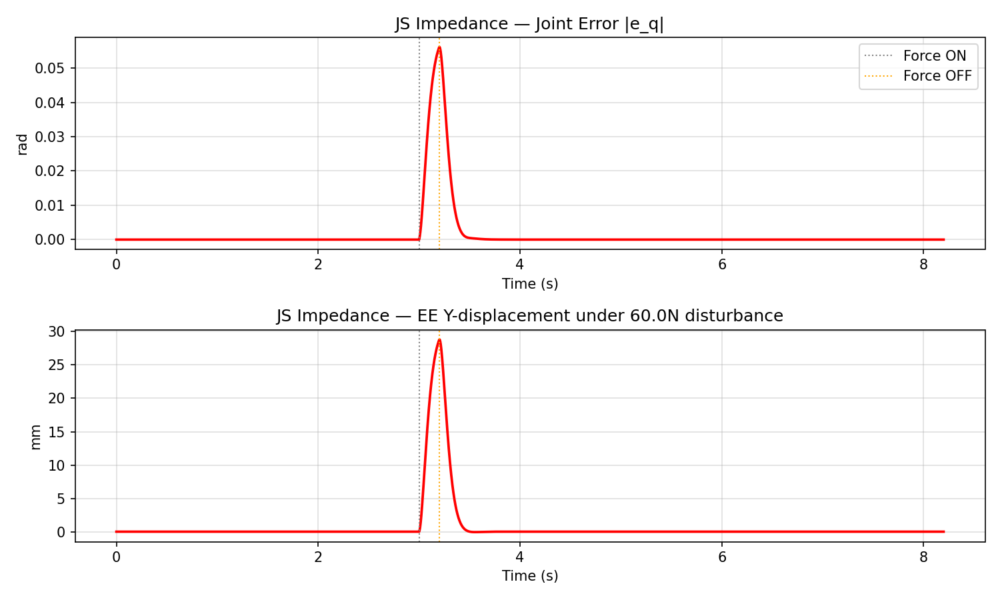

**CS vs JS comparison** (`test6_cs_vs_js.png`): a 30 N Y-axis force is applied from t = 3 s to t = 5 s.
- CS impedance gives a bounded, predictable deflection of about 36 mm. The end effector returns fully to the setpoint after release.
- The JS curve in this plot (end-effector Y swinging from roughly +470 mm to −630 mm, about 165 mm from the setpoint and about 6.5 rad joint error at the end) is **under review**. The script that produced it is not in this repository. A headless rerun of the JS controller with K = 500, ζ = 1 and the same 30 N load gave a peak joint error of about 0.02 rad and full recovery, which also agrees with the 60 N disturbance test above. The JS result in this plot is therefore not reproducible from the committed code and should not be read as a general property of joint-space impedance control.
- Until the comparison is rerun with a committed script, no conclusion is drawn here about which controller is better for compliant interaction.

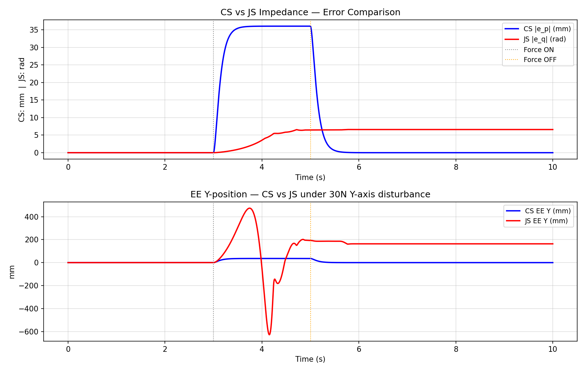

**Gain tuning under a 120 N load** (`controller_tuning.png`): force applied from t = 1 s to t = 3 s, with a 5 mm settling threshold.

| Config | Behaviour |
|---|---|
| A: k = 200, ζ = 1.0 | Largest deflection, peaking at about 370 mm |
| B: k = 800, ζ = 1.0 | Peaks of about 230 mm, then about 40 mm |
| C: k = 800, ζ = 2.0 | Smoothest, holding at about 145 mm then dropping to about 40 mm |
| D: k = 800, ζ = 0.5 | Spiky, with peaks of about 300 mm |

All four return to the low-millimetre range after the force is removed. A small noise floor of a few mm remains in each case.

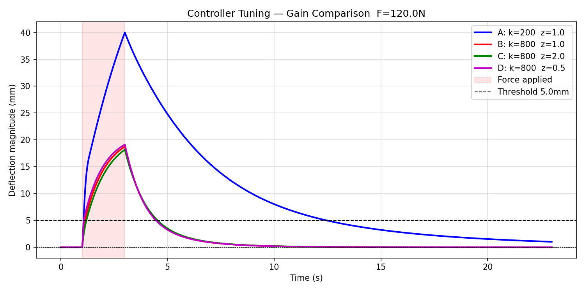

### Perception

Perception uses two simulated cameras, both 640×480. Intrinsics come from each camera's vertical field of view.
- **`fixed_cam`:** looks at the table from the side.
- **`wrist_cam`:** mounted on the hand.

**Fixed camera, at startup.** One frame is rendered with the arm at its home pose.
- **Cube:** red is segmented in HSV (two hue bands, because red wraps around 0°), cleaned up with morphological open/close, and the largest contour's centroid is taken. Depth at that pixel is back-projected to world coordinates, and half the cube size is subtracted to get the centre. This estimate is coarse: at the default pose it is (0.4495, −0.1692) against a true (0.45, −0.15), about 19 mm off in y. It is used only to place the arm above the cube.
- **Green patch:** green is segmented in HSV. Contours outside 300–700 px² are rejected, and the centroid is kept at sub-pixel precision. The patch is flat, so its pixel ray is intersected with the patch plane (z = 0.4015 m) instead of reading depth. The error is 1.56 mm in x–y at the default scene. Because the patch never moves, this is a constant bias, (−1.56, −0.01) mm in every trial.

**Wrist camera, at pre-grasp.** The arm holds 0.25 m above the coarse estimate, and the wrist camera re-detects the cube.
- **Position:** the same red segmentation plus depth back-projection, giving 1.55 mm error at the default pose. Over the 20 randomized trials the error was mean 1.22 mm, max 1.75 mm.
- **Yaw:** taken from the minimum-area rectangle around the cube's mask and wrapped to ±45°, since a cube looks the same every 90°. Error was mean 0.12°, max 1.38°. The grasp orientation is built from this yaw.

**Pose estimator (experimental, not used by the pipeline).** `test_pose_estimator.py` estimates the cube pose from detected corners. In the default scene it reports 5 correspondences, 2.15 px reprojection error, 30.48 mm translation error and 14.04° rotation error.

How these perception errors feed into the final placement error is broken down in [docs/error_budget.md](docs/error_budget.md).

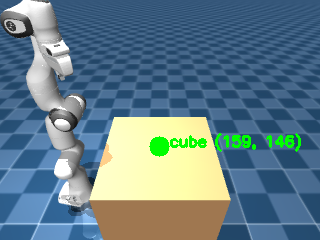

## Notes

- Initial validation was performed on a Franka Emika Panda 7-DOF robotic arm.
- The repository is actively evolving, especially around perception and vision stack integration.
- **Start pose:** both run scripts start the arm at `Q_HOME` (defined once in `envs/pick_scene.py`). Don't start from MuJoCo's default `qpos0` (all joints at 0). There the Panda stands straight up and fully extended, which is a singular configuration, and joint 4 sits just outside its limit. The joint-space pipeline (`run_pick_place.py`) handles that fine, but the Cartesian impedance pipeline (`run_impedance.py`) can't push the end-effector along the locked arm. In testing, it lagged the first trajectory by about 100 mm for the first second before catching up (normal tracking error is under 1 mm). If you change the start pose, also build the controller's initial hold target from the pose the arm is actually in (`fk(q_start)`). Otherwise the first-step error turns into a large torque spike and the arm shakes violently.
- Contributions are welcome.

