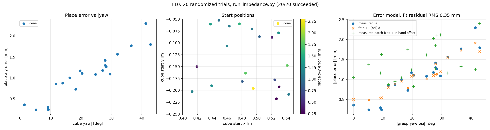
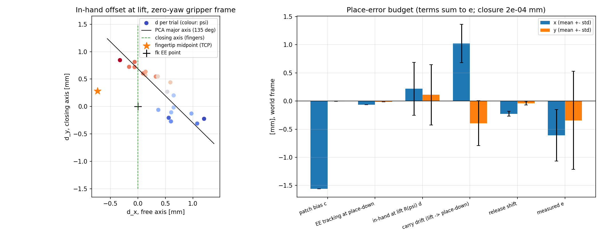

# Pick-and-place error budget (CS impedance pipeline)

This page summarizes a randomized-trial study of `scripts/run_impedance.py`, the camera-guided pick-and-place pipeline running on the Cartesian impedance controller. It answers two questions: how reliably the pipeline places the cube, and where the remaining placement error comes from.

All numbers come from one set of 20 seeded trials (seeds 0–19). The simulation is deterministic, so the same seeds always give the same trials.

> The instrumented pipeline, the trial script and the raw per-trial data are kept outside the public repository and are available on request. `master` contains only the clean pipeline. The two plots from the study are included below.

**Headline:** end-effector tracking contributes only 0.07 mm. The remaining placement error comes from perception bias (patch detection and the wrist camera) and from how the cube is handled (carry drift and release), not from the controller.

For reference, the earlier position-servo pipeline (`run_pick_place.py`) on the default cube pose, against `run_impedance.py`:

| | Position servo | Impedance |
|---|---|---|
| Grasp sag (commanded → reached z) | 5.0 mm (0.535 → 0.530) | 0.05 mm (0.5349 → 0.5348) |
| Place-down sag (commanded → reached z) | 5.5 mm (0.5395 → 0.534) | 0.31 mm (0.5395 → 0.5392) |
| Place error | 1.02 mm (earlier contact model), 1.53 mm (current) | 0.22 mm |

The sag values are commanded vs reached end-effector z, taken from each pipeline's run log.

## Setup

- **Cube start pose**, sampled per seed: x in [0.40, 0.55] m, y in [−0.25, −0.05] m, yaw in [−45°, 45°].
- **Pipeline:** unchanged from `run_impedance.py`.
  - Fixed-camera detection of the cube and the green patch, pre-grasp, then wrist-camera refinement of position and yaw.
  - Descend, close, lift 0.20 m, move above the patch, descend, release, retreat.
  - Controller: Kp = 1000, Kr = 100, critical damping, null-space posture control, passive-torque compensation. Contact model as in `assets/scene_pick.xml` and `envs/pick_scene.py`.
- **Place error e:** the cube's final x–y position minus the patch's true x–y centre.

## Results

| | |
|---|---|
| Success rate | **20/20** |
| Place error \|e\| | mean **1.08 mm**, std 0.53 mm, max 2.30 mm |
| Final cube tilt | 0.000° in every trial |
| Wrist-camera position error | mean 1.22 mm, max 1.75 mm |
| Wrist-camera yaw error | mean \|error\| 0.12°, max 1.38° |

The place error grows with the cube's starting yaw (correlation +0.94 with |yaw|):

| \|yaw\| | Trials | Mean \|e\| | Max \|e\| |
|---|---|---|---|
| 0–15° | 6 | 0.48 mm | 0.88 mm |
| 15–30° | 10 | 1.14 mm | 1.42 mm |
| 30–45° | 4 | 1.86 mm | 2.30 mm |

The default scene (cube at (0.45, −0.15), yaw 0) places with 0.22 mm error. That case is better than the average, because two of the terms below happen to cancel.



## Error budget

Each trial measured five terms in world x–y. Together they sum exactly to the place error: the largest difference between the sum and the measured e across the 20 trials is 2e-4 mm.

```
e = patch bias + EE tracking at place-down + R(ψ)·d + carry drift + release shift
```

Here ψ is the grasp yaw and d is the cube's offset from the end effector at lift, expressed in the gripper frame at zero yaw.

| Term | What it is | Mean x (mm) | Mean y (mm) | Std x / y (mm) | Corr. with \|ψ\| (x / y) |
|---|---|---|---|---|---|
| Patch bias c | detected patch centre − true centre (fixed camera) | −1.558 | −0.007 | 0.000 / 0.000 | constant |
| EE tracking | end-effector x–y − commanded place-down x–y, before release | −0.065 | −0.014 | 0.000 / 0.001 | +0.64 / +0.08 |
| In-hand offset at lift, R(ψ)·d | cube − end effector at lift, in world | +0.218 | +0.111 | 0.470 / 0.536 | −0.36 / −0.33 |
| Carry drift | change in (cube − end effector) between lift and place-down | **+1.023** | **−0.394** | 0.340 / 0.399 | −0.46 / +0.01 |
| Release shift | cube movement from place-down to its final rest | −0.226 | −0.039 | 0.042 / 0.033 | +0.53 / +0.07 |
| **Sum = measured e** | | −0.609 | −0.342 | 0.459 / 0.872 | −0.66 / −0.20 |

Average magnitudes: carry drift 1.175 mm, release shift 0.232 mm, tracking 0.067 mm.



- **Constant terms.** The patch bias and the carry drift are the two large, roughly constant terms, and they partly cancel in x.
- **Source of the yaw dependence.** It comes from the in-hand offset, which rotates with the grasp yaw ψ and varies from trial to trial.
- **Small terms.** End-effector tracking error at the place pose is negligible. The release shift is small but consistent, about −0.23 mm in x.
- **The simple two-term model does not work.** A least-squares fit of e = c + R(ψ)·d with constant c and d leaves 0.352 mm RMS. Its fitted values, c = (−2.52, −0.91) mm and d = (+2.11, +0.62) mm, disagree with the measured values above. Two reasons:
  - With ψ restricted to ±45°, cos ψ stays between 0.71 and 1, so the fit can trade the constant part of R(ψ)·d against c.
  - d is not constant, and the model leaves out the carry drift.

## In-hand offset: self-centering

The fingers close along the gripper's y axis: both slide joints point along world ±y at zero yaw. The gripper's x axis, along the finger faces, is the free axis.

The in-hand offset d lies close to a line: PCA gives principal standard deviations of 0.546 and 0.145 mm, with 93.4% of the variance on the major axis. That axis sits at 135.4° in the zero-yaw gripper frame. It is 45.4° from the closing axis, not the 90° that simple centering would predict.

The table below predicts d from the wrist-camera error w (refined − true cube position). Before the fingers close, the cube sits at −w relative to the end effector.

| Prediction of d | Residual RMS | Mean residual (x, y) |
|---|---|---|
| No centering: d = −w | 1.397 mm | (−0.260, +1.151) |
| Centering about the `fk` end-effector point | 0.555 mm | (−0.260, +0.280) |
| **Centering about the measured fingertip-pad midpoint** | **0.270 mm** | (−0.260, −0.004) |
| Best affine fit, d = M(−w) + k (upper bound on what w can explain) | 0.176 mm | (0, 0) |

- **Free axis.** The wrist-camera positioning error carries straight into the grasp. The in-hand offset along x tracks −w with correlation +0.99 and slope 0.88. Nothing corrects the cube's position along the finger faces.
- **Closing axis.** The cube is centred between the fingertip pads: d_y matches the pad midpoint's y offset with correlation +0.999, a mean difference of −0.004 mm and a std of 0.024 mm. The constant k_y = +0.57 mm in the affine fit, and the 45° tilt of the PCA line, come from the pad midpoint itself moving from trial to trial (next section).

## Fingertip-pad midpoint vs `fk`

With the fingers closed on the cube, the midpoint of the two fingertip pads is offset from the `fk` end-effector point by these amounts:

| Axis | Mean | Std |
|---|---|---|
| x (free axis) | −0.735 mm | 0.153 mm |
| y (closing axis) | +0.284 mm | 0.377 mm |
| z | −102.90 mm | n/a |

The fingers do not close symmetrically about the hand. The midpoint between the pads lands at a different point on the closing axis in each grasp, and that shift correlates +0.97 with the grasp yaw ψ.

## FINGER_LENGTH: 0.103 vs 0.11

The fingertip-pad midpoint sits **102.9 mm** below the `fk` end-effector point. The pipeline uses `FINGER_LENGTH = 0.11` when it computes the grasp and place-down heights.

- **At grasp:** the pads close about **7 mm above the cube's centre**, in the upper half of the cube rather than at mid-height. That is still within the cube's ±25 mm height, and all 20 grasps succeeded and lifted the cube.
- **At place-down, the offset cancels.** The cube is gripped 7 mm above its centre and stays at that offset in the hand, so its centre sits at end effector − 0.11 m throughout the carry. Place-down uses the same 0.11 m, so the cube's bottom ends up exactly the intended 3 mm (`PLACE_CLEARANCE`) above the patch.
- **The only effect is grip height.** Where the fingers grip the cube matters for grasp stability, and may relate to the tilt and slip seen in the earlier grasp-hold study (test9).
- **Status:** recorded as an observation only. `FINGER_LENGTH` has not been changed or tested at 0.103.

## Open questions (parked)

1. **Carry drift**, about 1.2 mm and the largest variable term. Two candidates, both unverified:
   - **Hand tilt.** Position is controlled at the hand origin, about 0.11 m above the cube, so a hand tilt of roughly 0.6° under the cube's weight would move the cube about 1.1 mm sideways. The orientation error at place-down was not logged.
   - **In-hand slip during the long sideways move.** Lateral acceleration while carrying the cube to the patch could make it slip between the fingers.
2. **Patch-detection bias**, −1.56 mm in x and constant across trials. It could be calibrated out, but the fix has not been tried.
3. **Free-axis residual**, −0.26 mm, left after centering about the pad midpoint; the pad midpoint is also offset −0.735 mm in x. Cause not investigated.
4. **Why the pad midpoint shifts** along the closing axis from grasp to grasp, and why that shift correlates with the grasp yaw. Possibly finger asymmetry; not investigated.
5. **Release shift**, a consistent −0.23 mm in x when the fingers open. Cause not investigated.
6. **`FINGER_LENGTH`** of 0.11 vs the measured 0.103 (previous section).
7. **Sample size.** 20 trials, with only 4 in the 30–45° yaw range. The yaw trend is clear, but the per-bin statistics are rough.
